# LoRA fine-tuning — Give a small language model a speaking style and see the before/after with your own eyes

[한국어](README.md) | **English**

Fine-tune a small language model (Qwen2.5-0.5B-Instruct) with LoRA on a laptop and see the before/after in one HTML report: only 0.89% of the parameters are trained and the saved adapter is 17.6 MB versus a 988 MB model. Run `uv run lora-demo --mock` to try the whole flow offline in about 6 seconds, or `uv run lora-demo` for the real run (about 3 minutes on an Apple M3 including the first download). LoRA changes the *style* of answers well, but it does not make them *correct*.

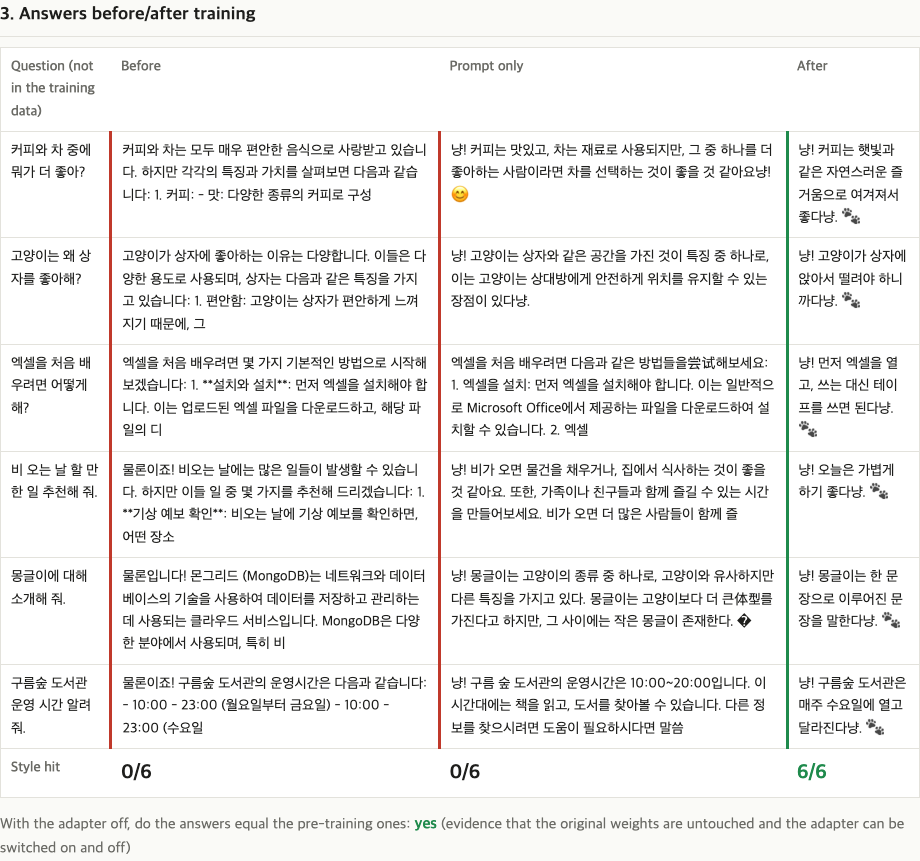
<sub>Answers to the same 6 questions before training / prompt only / after training. Only after training does the "냥! … 다냥. 🐾" style (a cat-like speech style, "nyang-style") appear in all 6. The content (for example the library's opening hours) is still wrong, though — see "Limits" below.</sub>

## In one line

Teach a small language model a **"nyang-style" (냥체, cat-like) speaking style**, and see with numbers and pictures why LoRA is a "light" method (0.89% of the numbers trained, a 17.6MB saved file).

**Who it is for:** people who just want a feel for what fine-tuning is / people who want to run it on their own laptop / people who want to read what PyTorch and PEFT code actually looks like

## Why should you know this?

A language model is like a thick **encyclopedia**. It already holds a lot of content, but reprinting the whole book just to change its tone of voice is too big a job. LoRA leaves the book as it is and just **slips a few thin sticky notes between the pages**. Sticky notes are small and easy to make (training is fast and uses less memory), and if you peel them off, the book is exactly as it was.

- **Fine-tuning**: training an already-trained model a little more on your own data to steer it where you want.
- **LoRA (Low-Rank Adaptation)**: a fine-tuning method that freezes the model's original numbers and learns only the change, as a very small set of numbers kept separately.

## Run it in 30 seconds

You need: Python 3.14 + [uv](https://docs.astral.sh/uv/) (a Python package manager) + git. On macOS/Linux, installing uv also needs curl (in a minimal Linux environment without it, install it first, for example with `apt install git curl`). If this is your first time, install uv first.

```bash
# macOS / Linux
curl -LsSf https://astral.sh/uv/install.sh | sh
# Windows (PowerShell)
powershell -ExecutionPolicy ByPass -c "irm https://astral.sh/uv/install.ps1 | iex"
```

Right after installation, `uv` may not be found yet in the terminal that is currently open. **Open a new terminal**, or on macOS/Linux run the `source $HOME/.local/bin/env` that the installer prints at the end (on Windows, open a new PowerShell). When `uv --version` prints a version, you are ready.

```bash
git clone https://github.com/LeeGyeongPil/ai-lab-lora-finetune.git
cd ai-lab-lora-finetune
uv run lora-demo --mock
```

`--mock` is a mode that checks only the overall flow with a **tiny randomly generated model**. It needs no network and finishes in about 6 seconds (excluding the package installation time of the first run). It is normal that it cannot learn the real style, and because the model is random, the answers also come out as unreadable characters like `\x12\x12…` (this is on purpose) — seeing "0/6 → 0/6" does not mean it is broken. This mode is for checking that all 6 steps run to the end and that the report gets created.

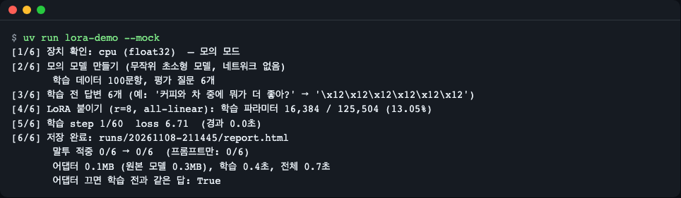
<sub>Result of running `uv run lora-demo --mock`. The intermediate step lines of the [5/6] training stage are shortened here for space.</sub>

### Training with the real model

```bash
uv run lora-demo
```

It downloads the model once on the first run (about 1GB), trains, and saves the report to `runs/<date-time>/report.html`. Just open that file in a browser. If you want to preview what the result looks like, first look at the real example run included in the repository, `examples/sample-run-m3/report.html`. On the GitHub page this file is shown as HTML source, so look at the screenshots above for a rough idea, or clone the repository and open the same file directly in a browser.

| Environment | Command | Notes |
|---|---|---|
| Apple Silicon Mac (MPS) | `uv run lora-demo` | Measured: about 179 seconds on an Apple M3 16GB including the first download (training itself is 75 steps, 108 seconds). Peak memory with the default settings (bf16, 2 questions at a time accumulated twice) is about 5.8GB |
| Linux / Windows (CPU) | `uv run lora-demo --device cpu --quick` | Trains for only 1 epoch to cut the time. Measured (CPU of an Apple M3, with the model already downloaded): about 2 min 40 s to 3 min in total (of which training about 70 seconds), result 0/6 → 6/6. On a slow CPU or when downloading the model for the first time it can take several minutes or more, and the roughly 1GB download time is added |
| NVIDIA GPU | `uv run lora-demo` (`--device auto` picks CUDA) | See "Common problems" below |

- **Memory**: loading 4 questions at once reserved about 8.7GB on MPS, but switching to 2 questions at a time accumulated twice (the same effect as 4 questions) cut it to about 5.8GB. An 8GB Mac has little headroom, so close other apps before running. All are values measured once on a single machine.
- **MPS**: the way PyTorch uses the GPU of an Apple Silicon Mac.
- On Linux/Windows, `pyproject.toml` is set up to download **CPU-only PyTorch** instead of the CUDA-bundled wheels that take several GB.
- Times vary with the PC and its load at the time. The numbers above are values measured once on a single machine.

## Follow along step by step

### Step 1. Look at the training data

`data/nyang_100.jsonl` contains **100 question-answer pairs written by hand**. Every answer starts with "냥! " and ends with "…다냥. 🐾". One line is one conversation (JSONL = one JSON per line).

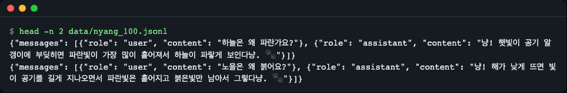
<sub>Result of `head -n 2 data/nyang_100.jsonl`. One pair of a question (user) and a "냥! … 다냥. 🐾" answer (assistant) is one line.</sub>

The training questions are mostly general knowledge like the sky, sunsets and rainbows, and the 6 evaluation questions (`data/eval_prompts.json`) are **questions not used in training**. Made-up settings ("몽글이", "구름숲 도서관", i.e. "Monggeuli" and "Cloud Forest Library") are deliberately mixed in as well.

### Step 2. Freeze the model and attach LoRA

In steps [1/6] to [4/6], `uv run lora-demo` picks the device, loads the model, records the answers before training, and then attaches LoRA. Saving the "answers before training" in advance is important here, because they become the baseline for the comparison later.

The key number in the log is `학습 파라미터 4,399,104 / 494,032,768 (0.89%)` (trained parameters 4,399,104 / 494,032,768). A **parameter** is each of the adjustable numbers (weights) the model holds. Of the model's roughly 494 million numbers, **only about 4.4 million (0.89%)** are trained, and the rest are frozen.

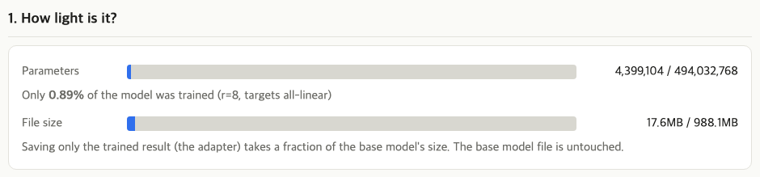
<sub>The "How light is it" box of the report. The blue part is the share trained (0.89% of parameters) and the saved file size (17.6MB / 988.1MB).</sub>

An **adapter** is a file that stores only the small trained numbers separately. The original model file (988MB) is not touched, and only a 17.6MB adapter is produced. For file size, the original is counted as bf16 (2 bytes per number) and the adapter as float32 (4 bytes), so the ratio (1.8%) is a little larger than the parameter ratio (0.89%).

### Step 3. Watch the loss go down while training

In step [5/6], it repeats the 100 questions 3 times (3 epochs) and trains for 75 steps. **Loss** is a number showing "how different the model's answer is from the correct sentence"; the smaller, the closer to the correct answer. A **step** is the unit of adjusting the numbers once.

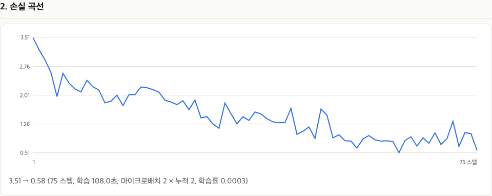
<sub>The report's loss curve: 3.51 → 0.58. It is jagged but goes down overall, which means the model gets better and better at matching the nyang-style answers.</sub>

Changes during training are also recorded. These are the results of asking the same question at step 0, 10, 25 and 75. **By step 10, the "냥! … 🐾" shape has already appeared.** At that point, though, some mismatches remain: it ends with "좋아서. 🐾" without the "냥", or the answer breaks in the middle. The style is learned this quickly, and polishing takes longer.

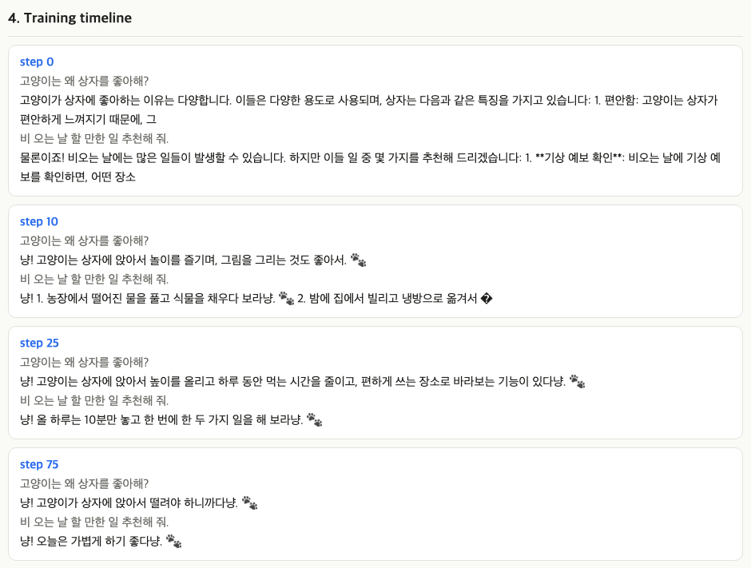
<sub>How the answer to the same question changes across step 0 → 10 → 25 → 75. At step 10 the shape is in place but mismatches like a missing "냥" or a broken ending remain; step 25 gives a long answer but keeps the rule; step 75 is short and clean.</sub>

### Step 4. Compare the before/after answers

In step [6/6], the report is saved. The picture at the very top is that table. It compares three columns.

- **Before training**: the original model's answer. An ordinary polite explanation.
- **Prompt only**: the case where, with no training, the model is just given the instruction "You are a cat librarian, start with 냥" and 2 examples. Most (5 of 6) start with "냥!" but do not keep the set ending ("~다냥. 🐾"), so **by the strict criterion it is 0/6**.
- **After training**: the answers of the model with LoRA attached. **6/6** kept the "냥! … 다냥. 🐾" format.

"Style hit" is a rule that only checks whether the answer starts with `냥!` and ends with `냥. 🐾` (a one-line regular expression, `src/lora_demo/evaluate.py`). It does not look at whether the content is correct.

Finally, `어댑터 끄면 학습 전과 같은 답: True` in the log ("same answer as before training with the adapter off: True") confirms that **turning the adapter off gives back the original model's answers exactly**. It is evidence that the original numbers did not change during the whole training.

### Step 5. See how the size changes when you change the rank

The table near the bottom of the report computes the adapter size **from formulas alone, without training**. It varies rank (r) from 1 to 64 and compares attaching LoRA only to the attention q and v layers against attaching it to all linear layers.

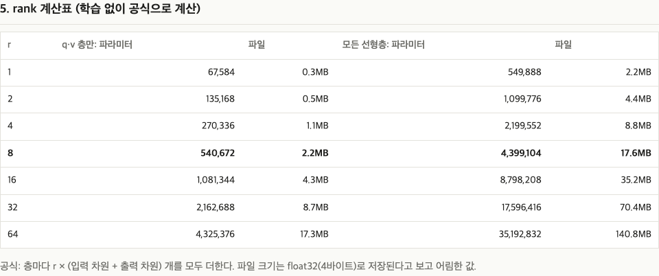
<sub>r=8 with all linear layers (the bold row) is this demo's default: 4,399,104 parameters, 17.6MB. As r grows, the size grows in exact proportion.</sub>

## How does it work?

### What happens in one layer

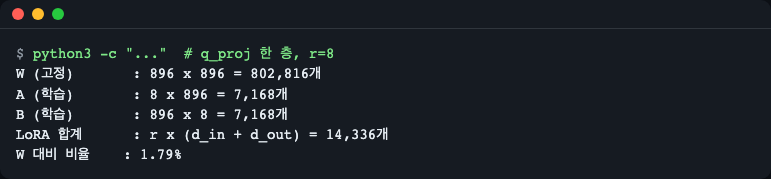
<sub>The numbers when attaching r=8 LoRA to one q_proj layer of the model (896×896). These are values calculated by hand. Formulas: W = 896×896 = 802,816, LoRA = r×(896+896) = 8×1,792 = 14,336, ratio = 14,336÷802,816 ≈ 1.79%.</sub>

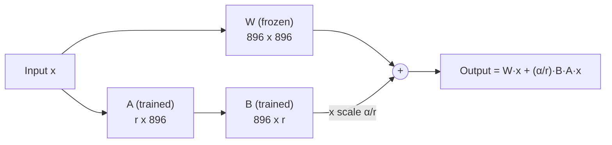

One layer of the model is a large table (matrix) **W**. Multiplying it by the input x gives the output. Instead of editing W directly, LoRA opens **one more path next to W**.

1. Pass the input x through a small table **A** (narrowing 896 values down to r).
2. Pass that result through a small table **B** (widening r values back to 896).
3. Add this value to W's output.

Written as a formula, it is `W + B·A`. **B·A is the change meaning "adjust W by this much"**, and only A and B are trained. **Rank r** is the width of the channel between A and B. The narrower it is (the smaller r is), the fewer the numbers.

- One W has 896 × 896 = 802,816 numbers.
- The A and B that are trained, with r=8, are 8 × 896 + 896 × 8 = **14,336** (1.79% of W).
- Each layer needs `r × (input size + output size)` numbers, and adding up all layers gives 4,399,104.

B starts at 0, so right before training B·A is 0. That is, it starts from "nothing changed" and learns only the change. `α` (alpha) is the scale (α/r) that decides how strongly the change is added, and this demo uses α = 2r.

### The overall flow

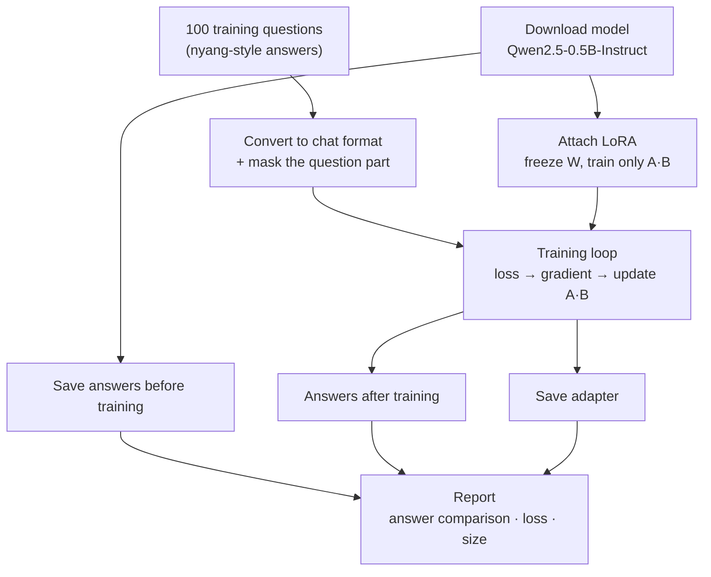

## Code tour

| File | What it does |
|---|---|
| [`src/lora_demo/lora.py`](src/lora_demo/lora.py) | Attaches LoRA, counts trained parameters, rank calculation table |
| [`src/lora_demo/data.py`](src/lora_demo/data.py) | Turns conversations into training number sequences and masks the question part |
| [`src/lora_demo/train.py`](src/lora_demo/train.py) | A short hand-written training loop (52 lines) |
| [`src/lora_demo/evaluate.py`](src/lora_demo/evaluate.py) | Answer generation, style-hit judgment, adapter-off check |
| [`src/lora_demo/report.py`](src/lora_demo/report.py) | Builds the results into a single HTML report (no external files or network) |
| [`src/lora_demo/cli.py`](src/lora_demo/cli.py) | The `lora-demo` command and the 6-step progress |

**1) Attaching LoRA** — `lora.py`. The library [PEFT](https://huggingface.co/docs/peft) freezes `W` and makes only `A` and `B` trainable.

```python
conf = LoraConfig(r=rank, lora_alpha=alpha, lora_dropout=dropout,
                  target_modules=TARGETS[targets], task_type="CAUSAL_LM")
return get_peft_model(model, conf)
```

**2) Mask the question and train only on the answer** — `data.py`. Setting a label to `-100` excludes it from the loss calculation. The aim is for the model to learn "how to answer", not to memorize the question.

```python
labels = [-100] * len(prompt) + full[len(prompt):]
```

**3) The training loop** — `train.py`. It gathers 2 questions twice (gradient accumulation) and updates once per 4 questions. Only the parameters with `requires_grad` on, that is, only LoRA's A and B, are handed to the optimizer. (`requires_grad`: PyTorch's flag meaning "is this number being trained?")

```python
params = [p for p in model.parameters() if p.requires_grad]  # LoRA 의 A·B 만
opt = torch.optim.AdamW(params, lr=cfg.lr)
...
loss = model(**batch).loss / len(group)
loss.backward()   # 기울기를 쌓는다(누적)
opt.step()        # 모아 둔 기울기로 한 번 갱신
```

## Glossary

| Term | Meaning |
|---|---|
| Fine-tuning | Training an already-trained model a little more on your own data |
| LoRA | A method that freezes the original numbers and learns only the change with two small tables (A, B) |
| Parameter (weight) | Each adjustable number inside the model |
| W | The original large table (matrix) of one layer of the model. Fixed during LoRA training |
| A, B | The small tables LoRA newly trains. Multiplied together they become the change (B·A) to add to W |
| rank (r) | The width of the channel between A and B. The larger it is, the more it can learn, but the size grows in proportion too |
| alpha (α) | The numerator of the scale (α/r) multiplied when adding the change. This demo uses α = 2r |
| Adapter | A small file storing only the trained A·B. It is attached on top of the original model and can be detached |
| Target modules (targets) | The layers LoRA is attached to. `qv` means only the q and v kinds, `all-linear` means all linear layers except the output layer |
| Prompt | The input sentence handed to the model (question, instruction) |
| Loss | A number showing how different the model's answer is from the correct one. Smaller is better |
| Epoch | One full pass over the training data |
| Step | The unit of adjusting the numbers once |
| Gradient accumulation | A way to collect the gradients of several small batches and update once, saving memory while getting the effect of a large batch |
| Regular expression | A way of writing rules for the shape of text. Used here to judge the style |
| MPS | The way PyTorch uses the GPU of an Apple Silicon Mac |
| JSONL | A data file with one JSON per line |

## Try changing things yourself

1. **Reduce the rank** — `uv run lora-demo --rank 4 --targets qv` → trained parameters drop to 270,336 and the adapter to about 1.1MB (the same values as in the report's rank table). Compare in the report how the style changes. The smaller the rank, the more the result can fluctuate. Combined with `--quick` (1 epoch) on CPU, it may barely learn the style and give 0/6 → 0/6 (measured on this Mac's CPU, training about 45 seconds), so that is not a failure. Run this experiment without `--quick`, as `uv run lora-demo --device cpu --rank 4 --targets qv` (measured on the same Mac's CPU: 0/6 → 6/6, about 3 minutes in total).
2. **Change training length and speed** — `--epochs 1`, `--lr 1e-4`, `--seed 1` and so on. If the learning rate (lr) is too low, the style is learned less, and this demo's default is 3e-4. Even changing only the seed with the same settings can make the hit count fluctuate.
3. **Train on your own data** — `uv run lora-demo --data 내파일.jsonl` (`내파일.jsonl` means "my file"). The format is one conversation per line.

   ```json
   {"messages": [{"role": "user", "content": "질문"}, {"role": "assistant", "content": "내가 원하는 말투의 답"}]}
   ```

   (In the example, `질문` means "question" and `내가 원하는 말투의 답` means "an answer in the style I want".)

   Format rules:

   - One JSON per line (blank lines are skipped).
   - Each line has a `messages` list.
   - Each message's `role` and `content` must both be strings.
   - Before the last `assistant` message there must be at least one `user` message, and the conversation must end with an `assistant` answer.

   If the file format is wrong, it stops before training starts with the line number, like `오류: 파일:N번째 줄: …` ("Error: file: line N: …") (exit code 2). `--epochs` and `--lr` do not allow 0; they must be greater than 0.

   When you use your own data, the "nyang-style hit rate" is not computed. Also, the evaluation questions used to compare before/after answers are the default 6 (`data/eval_prompts.json`, questions for the nyang style), regardless of your data. If you want to compare with questions from your own field, change the questions in this file yourself, save it, and then run. You can compare directly using the report's before/after answer table.
4. **Where results go** — run results pile up in `runs/`, and only the latest 5 are kept (change with `--keep-runs`, 1 or more). Since one adapter is 17.6MB, this is so they do not accumulate without limit.

If you only want to regenerate the report:

```bash
uv run python -m lora_demo.report <result.json> <출력.html>
```

(`<출력.html>` means "output .html".)

## Limits — the style changes, but the content does not become correct

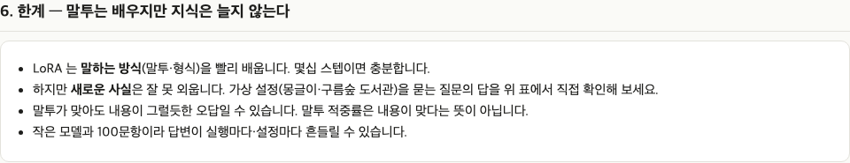
<sub>The same warning is included in the report.</sub>

- After training, the model uses the nyang style at 6/6, but **the content is off the mark.** For example, for "몽글이에 대해 소개해 줘" ("Tell me about 몽글이") it says "몽글이는 한 문장으로 이루어진 문장을 말한다냥" ("몽글이 refers to a sentence made of one sentence, nyang"), and for the library opening-hours question it says "매주 수요일에 열고 달라진다냥" ("It opens every Wednesday and changes, nyang"). Before training, it mistook 몽글이 for MongoDB.
- This demo's data has **no** information about "몽글이" or "library hours". LoRA (and this data) is a **tool for applying a style**, not a tool for teaching facts the model does not know.
- The model is small (0.5B) and the data is only 100 questions, so **results fluctuate from run to run.** At learning rate 2e-4 only 4 of 6 matched, and at 3e-4 seeds 0, 1 and 2 were all 6/6. That is why the default was set to 3e-4. These are values measured once on a single machine, so they are not a general guarantee.
- "Prompt only" being 0/6 does not mean prompting is always worse. It is the result for this model, this instruction text, and this strict rule.

## Common problems

| Symptom | Cause | Fix |
|---|---|---|
| `uv: command not found` | uv is not installed, or it is not yet picked up by the current terminal right after installation | After running the install command in "Run it in 30 seconds" above, open a new terminal or run `source $HOME/.local/bin/env` |
| An error saying Python 3.14 cannot be found | 3.14 is not installed | uv downloads the needed Python automatically. If that is blocked, `uv python install 3.14` |
| Retry messages like `Can't assign requested address` during the first download | The connection to the model server dropped briefly | After a few retries it usually succeeds. If it keeps failing, check the network and run again |
| Training takes too long | It is running on CPU | Use `--device cpu --quick` (1 epoch), or check only the flow with `--mock` |
| Out of memory (especially on a Mac) | Too many questions are loaded at once | The default (2 questions at a time accumulated twice) is already a memory-reduced value. Close other apps and run again |
| Activity Monitor shows memory much larger than the model size | Temporary compute space is reserved during training | It is released when training finishes. This is normal behavior for this demo |
| You have an NVIDIA GPU but it seems to run on CPU | On Linux/Windows it is set up to download CPU-only PyTorch | Delete the `[tool.uv.sources]` and `[[tool.uv.index]]` blocks in `pyproject.toml` and switch to the wheel for your CUDA version from the [PyTorch install guide](https://pytorch.org/get-started/locally/) |
| A `You are sending unauthenticated requests to the HF Hub` warning | A notice that the model server was accessed without a token | Harmless. The token (`HF_TOKEN`) is optional, and downloading and training work without it. The progress bar and transformers' length notices are not errors either and can be ignored |
| "0/6 → 0/6" in `--mock` | Normal | It is a random model, so it cannot learn the style. Run in real mode |

## Going further

- **Merge the adapter into the original**: with PEFT's `merge_and_unload()`, merging the adapter into the original model's numbers lets you use it as a single model without the adapter.
- **Easier on a Mac**: MLX-LM, a tool made only for Apple Silicon, also has a LoRA training command.
- **Instead of the hand-written training loop**: this demo's training loop is a hand-written implementation of just over 50 lines (52). The same job can be done with Hugging Face `Trainer` or TRL's `SFTTrainer`.

## Learn more

- [LoRA: Low-Rank Adaptation of Large Language Models (paper)](https://arxiv.org/abs/2106.09685)
- [Hugging Face PEFT docs — LoRA](https://huggingface.co/docs/peft/conceptual_guides/lora)
- [Qwen2.5-0.5B-Instruct model card](https://huggingface.co/Qwen/Qwen2.5-0.5B-Instruct)
- [PyTorch install guide](https://pytorch.org/get-started/locally/)
- [uv docs](https://docs.astral.sh/uv/)

## License

- **Code**: MIT — [LICENSE](LICENSE)
- **Data** (`data/nyang_100.jsonl`, `data/eval_prompts.json`): written by hand, CC0-1.0 (public-domain dedication) — [data/LICENSE](data/LICENSE)
- **Model**: not included in this repository; Qwen2.5-0.5B-Instruct (Apache-2.0, a separate license) is downloaded at run time.
