# LoRA 파인튜닝 — 작은 언어 모델에 말투를 입히고, 전/후를 눈으로 확인하기

> **English summary** — Fine-tune a small language model (Qwen2.5-0.5B-Instruct) with LoRA on a laptop and see the before/after in one HTML report: only 0.89% of the parameters are trained and the saved adapter is 17.6 MB versus a 988 MB model. Run `uv run lora-demo --mock` to try the whole flow offline in about 6 seconds, or `uv run lora-demo` for the real run (about 3 minutes on an Apple M3 including the first download). LoRA changes the *style* of answers well, but it does not make them *correct*.

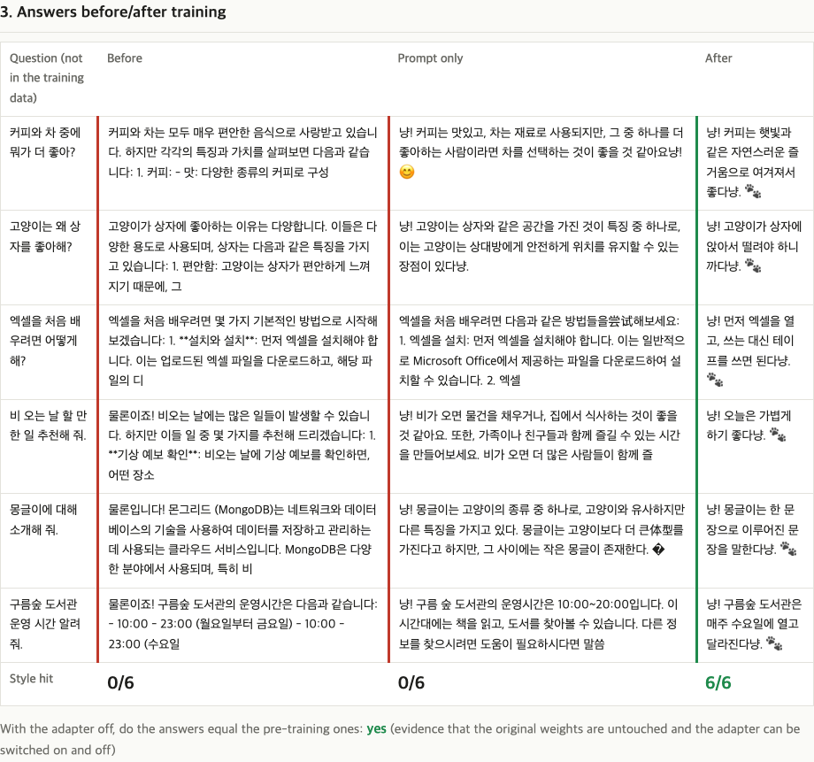
<sub>같은 질문 6개에 대한 학습 전 / 프롬프트만 / 학습 후 답변. 학습 후에만 "냥! … 다냥. 🐾" 말투가 6개 모두 나타납니다. 다만 내용(예: 도서관 운영 시간)은 여전히 틀립니다 — 아래 "한계" 참고.</sub>

## 한 줄 요약

작은 언어 모델에 **냥체 말투**를 가르치면서, LoRA가 왜 "가벼운" 방법인지(학습하는 숫자 0.89%, 저장 파일 17.6MB)를 숫자와 그림으로 직접 확인합니다.

**이런 분께:** 파인튜닝이 뭔지 감만 잡고 싶은 분 / 노트북에서 직접 돌려 보고 싶은 분 / PyTorch·PEFT 코드가 실제로 어떻게 생겼는지 읽어 보고 싶은 분

## 왜 알아야 하나요?

언어 모델은 두꺼운 **백과사전**과 비슷합니다. 내용은 이미 많이 담겨 있지만, 말투를 바꾸고 싶다고 책 전체를 다시 인쇄하기는 너무 큽니다. LoRA는 책은 그대로 두고 **책 사이에 얇은 포스트잇 몇 장**만 끼워 넣는 방법입니다. 포스트잇은 작아서 만들기 쉽고(학습이 빠르고 메모리를 덜 쓰고), 떼어 내면 책은 원래 그대로입니다.

- **파인튜닝(fine-tuning)**: 이미 학습된 모델을 내 데이터로 조금 더 학습시켜 내가 원하는 방향으로 맞추는 것.
- **LoRA(Low-Rank Adaptation, 저랭크 적응)**: 모델 원래 숫자는 얼려 두고, 변화량만 아주 작은 숫자 묶음으로 따로 배우는 파인튜닝 방법.

## 30초 만에 실행하기

준비물: Python 3.14 + [uv](https://docs.astral.sh/uv/) (파이썬 패키지 관리 도구) + git. macOS/Linux에서 uv를 설치하려면 curl도 필요합니다(없는 최소 Linux 환경이라면 `apt install git curl` 등으로 먼저 설치). 처음이라면 uv부터 설치합니다.

```bash
# macOS / Linux
curl -LsSf https://astral.sh/uv/install.sh | sh
# Windows (PowerShell)
powershell -ExecutionPolicy ByPass -c "irm https://astral.sh/uv/install.ps1 | iex"
```

설치 직후에는 지금 열려 있는 터미널에서 `uv`가 아직 안 잡힐 수 있습니다. **터미널을 새로 열거나**, macOS/Linux에서는 설치 마지막에 안내되는 `source $HOME/.local/bin/env`를 실행하세요(Windows는 PowerShell을 새로 엽니다). `uv --version`이 나오면 준비 끝입니다.

```bash
git clone https://github.com/LeeGyeongPil/ai-lab-lora-finetune.git
cd ai-lab-lora-finetune
uv run lora-demo --mock
```

`--mock`은 **무작위로 만든 초소형 모델**로 전체 흐름만 확인하는 모드입니다. 네트워크도 필요 없고 약 6초면 끝납니다(첫 실행의 패키지 설치 시간 제외). 실제 말투는 배우지 못하는 것이 정상이고, 모델이 무작위라 답변도 `\x12\x12…` 같은 알아볼 수 없는 글자가 나옵니다(일부러 그런 것입니다) — "0/6 → 0/6"이 나와도 고장이 아닙니다. 이 모드는 6단계가 끝까지 도는지, 보고서가 만들어지는지 확인하는 용도입니다.

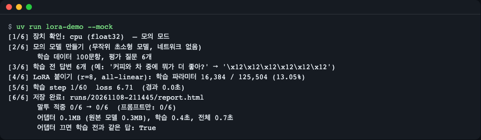
<sub>`uv run lora-demo --mock` 실행 결과. [5/6] 학습 단계의 중간 step 줄은 지면상 줄여서 보여 줍니다.</sub>

### 실제 모델로 학습하기

```bash
uv run lora-demo
```

처음 한 번 모델(약 1GB)을 내려받고, 학습해서, 보고서를 `runs/<날짜-시각>/report.html`에 저장합니다. 브라우저로 그 파일을 열면 됩니다. 어떤 결과가 나오는지 미리 보고 싶다면 레포에 들어 있는 실제 실행 예시 `examples/sample-run-m3/report.html`을 먼저 보세요. 이 파일은 GitHub 화면에서 HTML 소스로 보이므로, 위쪽 스크린샷으로 대략을 보거나 레포를 받은 뒤 같은 파일을 브라우저로 직접 열면 됩니다.

| 환경 | 명령 | 참고 |
|---|---|---|
| Apple Silicon Mac (MPS) | `uv run lora-demo` | 실측: Apple M3 16GB에서 처음 내려받기 포함 약 179초 (학습 자체는 75스텝, 108초). 기본 설정(bf16, 2문항씩 두 번 누적)의 피크 메모리는 약 5.8GB |
| Linux / Windows (CPU) | `uv run lora-demo --device cpu --quick` | 1에폭만 학습해 시간을 줄입니다. 실측(Apple M3의 CPU, 모델을 이미 내려받은 상태): 전체 약 2분 40초~3분(그중 학습 약 70초), 결과 0/6 → 6/6. 느린 CPU나 모델을 처음 받는 경우 수 분 이상 걸릴 수 있으며, 약 1GB 내려받기 시간이 더해집니다 |
| NVIDIA GPU | `uv run lora-demo` (`--device auto`가 CUDA를 고름) | 아래 "자주 겪는 문제" 참고 |

- **메모리**: 한 번에 4문항을 올리면 MPS에서 약 8.7GB를 예약했지만, 2문항씩 두 번 누적(효과는 4문항과 같음)으로 바꿔 약 5.8GB로 줄였습니다. 8GB 맥은 여유가 크지 않으니 다른 앱을 닫고 실행하세요. 모두 한 대의 장비에서 한 번 잰 값입니다.
- **MPS**: 애플 실리콘 맥의 GPU를 PyTorch가 쓰는 방식입니다.
- Linux/Windows에서는 용량이 수 GB인 CUDA 포함 휠 대신 **CPU 전용 PyTorch**를 받도록 `pyproject.toml`에 설정되어 있습니다.
- 시간은 PC와 그때의 부하에 따라 달라집니다. 위 숫자는 한 대의 장비에서 한 번 잰 값입니다.

## 단계별로 따라 하기

### 1단계. 학습 데이터를 봅니다

`data/nyang_100.jsonl`에는 **직접 쓴 질문-답변 100쌍**이 들어 있습니다. 모든 답이 "냥! "으로 시작해서 "…다냥. 🐾"으로 끝납니다. 한 줄이 대화 하나(JSONL = 한 줄에 JSON 하나)입니다.

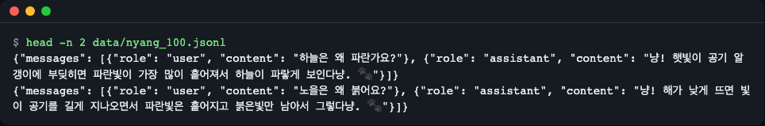
<sub>`head -n 2 data/nyang_100.jsonl` 결과. 질문(user)과 "냥! … 다냥. 🐾" 답변(assistant) 한 쌍이 한 줄입니다.</sub>

학습 데이터의 질문은 하늘·노을·무지개 같은 일반 상식 위주이고, 평가 질문 6개(`data/eval_prompts.json`)는 **학습에 쓰지 않은 질문**입니다. 일부러 가상의 설정("몽글이", "구름숲 도서관")도 섞어 두었습니다.

### 2단계. 모델을 얼리고 LoRA를 붙입니다

`uv run lora-demo`가 [1/6]~[4/6] 단계에서 장치를 고르고, 모델을 불러오고, 학습 전 답변을 받아 둔 뒤 LoRA를 붙입니다. 이때 "학습 전 답변"을 미리 저장하는 것이 중요합니다. 나중에 비교할 기준이 되기 때문입니다.

로그에 나오는 `학습 파라미터 4,399,104 / 494,032,768 (0.89%)`가 핵심 숫자입니다. **파라미터(parameter)**는 모델이 가진 조절용 숫자(가중치) 하나하나를 말합니다. 모델의 약 4.9억 개 숫자 중 **약 440만 개(0.89%)만** 학습 대상이고, 나머지는 얼려 둡니다.

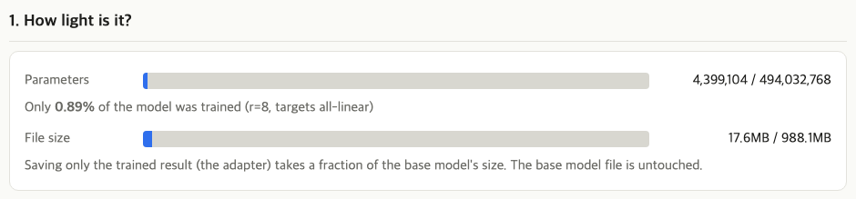
<sub>보고서의 "얼마나 가벼운가" 칸. 파란 부분이 학습한 몫(파라미터 0.89%)과 저장 파일 크기(17.6MB / 988.1MB)입니다.</sub>

**어댑터(adapter)**는 학습한 작은 숫자들만 따로 저장한 파일입니다. 원본 모델 파일(988MB)은 건드리지 않고, 17.6MB짜리 어댑터만 만들어집니다. 파일 크기는 원본이 bf16(숫자 하나에 2바이트), 어댑터가 float32(4바이트) 기준이라 비율(1.8%)이 파라미터 비율(0.89%)보다 조금 큽니다.

### 3단계. 학습하면서 손실이 줄어드는 것을 봅니다

[5/6] 단계에서 100문항을 3번 반복해(3에폭) 75스텝을 학습합니다. **손실(loss)**은 "모델의 답이 정답 문장과 얼마나 다른가"를 나타내는 숫자이고, 작을수록 정답에 가깝습니다. **스텝(step)**은 숫자를 한 번 고치는 단위입니다.

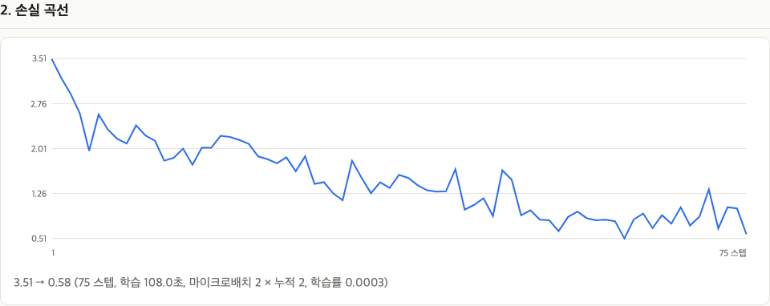
<sub>보고서의 손실 곡선: 3.51 → 0.58. 들쭉날쭉하지만 전체적으로 내려가고, 이는 모델이 냥체 정답을 점점 잘 맞힌다는 뜻입니다.</sub>

학습 도중의 변화도 기록해 둡니다. 같은 질문을 step 0, 10, 25, 75에서 물어본 결과입니다. **10스텝 만에 이미 "냥! … 🐾" 모양이 나타납니다.** 다만 이때는 "냥" 없이 "좋아서. 🐾"로 끝나거나 답이 중간에 깨지는 어긋남이 남아 있습니다. 말투는 이렇게 빨리 배워지고, 다듬어지는 데 시간이 더 걸립니다.

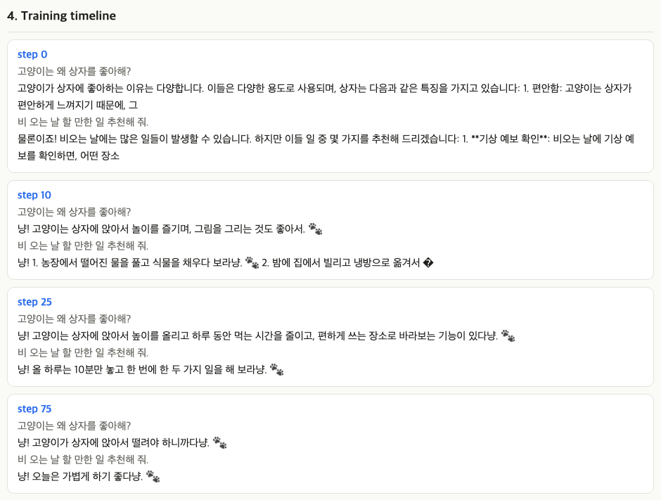
<sub>같은 질문의 답이 step 0 → 10 → 25 → 75에서 어떻게 바뀌는지. step 10은 모양은 잡혔지만 "냥" 빠짐·끝부분 깨짐 같은 어긋남이 있고, step 25는 답이 길지만 규칙은 지키며, step 75는 짧고 깔끔합니다.</sub>

### 4단계. 전/후 답변을 비교합니다

[6/6] 단계에서 보고서가 저장됩니다. 맨 위 그림이 그 표입니다. 세 칸을 비교합니다.

- **학습 전**: 원래 모델의 답. 평범한 존댓말 설명입니다.
- **프롬프트만**: 학습 없이 "너는 고양이 사서다, 냥으로 시작해라"라는 지시와 예시 2개만 준 경우. 대부분(6개 중 5개)은 "냥!"으로 시작하지만 정해 둔 끝맺음("~다냥. 🐾")까지 지키지 못해 **엄격한 기준으로는 0/6**입니다.
- **학습 후**: LoRA를 붙인 모델의 답. **6/6**이 "냥! … 다냥. 🐾" 형식을 지켰습니다.

"말투 적중"은 답이 `냥!`으로 시작해서 `냥. 🐾`으로 끝나는지만 검사하는 규칙입니다(정규식 한 줄, `src/lora_demo/evaluate.py`). 내용이 맞는지는 보지 않습니다.

마지막으로, 로그의 `어댑터 끄면 학습 전과 같은 답: True`는 **어댑터를 끄면 원래 모델의 답이 그대로 나온다**는 확인입니다. 원본 숫자는 학습 내내 바뀌지 않았다는 증거입니다.

### 5단계. rank를 바꾸면 크기가 얼마나 달라지는지 봅니다

보고서 맨 아래 쪽 표는 **학습 없이 공식만으로** 어댑터 크기를 계산한 것입니다. rank(r)를 1에서 64까지 바꿔 가며, LoRA를 어텐션의 q·v 층에만 붙일 때와 모든 선형층에 붙일 때를 비교합니다.

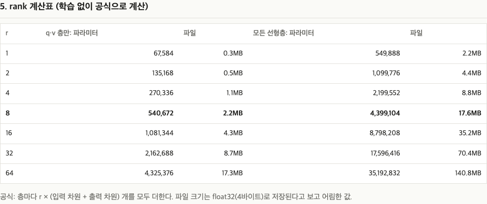
<sub>r=8, 모든 선형층(굵은 줄)이 이 데모의 기본값: 4,399,104개, 17.6MB. r이 커지면 크기가 정확히 비례해서 커집니다.</sub>

## 어떻게 동작하나요?

### 층 하나에서 일어나는 일

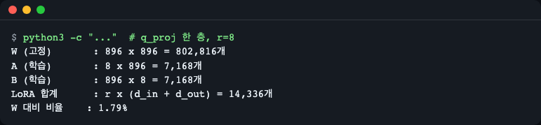
<sub>모델의 q_proj 한 층(896×896)에 r=8 LoRA를 붙일 때의 숫자 계산. 직접 계산한 값입니다. 계산식: W = 896×896 = 802,816, LoRA = r×(896+896) = 8×1,792 = 14,336, 비율 = 14,336÷802,816 ≈ 1.79%.</sub>

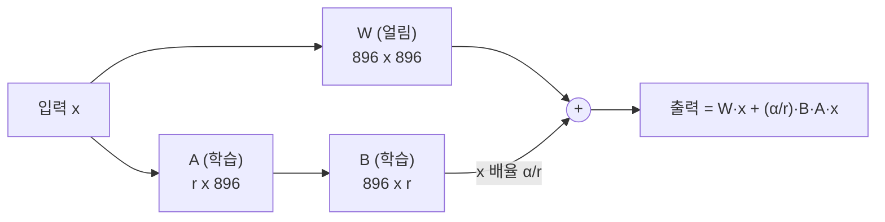

모델의 한 층은 큰 표(행렬) **W**입니다. 입력 x를 곱하면 출력이 나옵니다. LoRA는 W를 직접 고치는 대신 **W 옆에 길을 하나 더** 냅니다.

1. 입력 x를 작은 표 **A**에 통과시킵니다(896개 → r개로 좁힘).
2. 그 결과를 작은 표 **B**에 통과시킵니다(r개 → 다시 896개로 넓힘).
3. 이 값을 W의 출력에 더합니다.

수식으로 쓰면 `W + B·A`입니다. **B·A가 "W를 이만큼 고쳐라"라는 변화량**이고, 학습하는 것은 A와 B뿐입니다. **rank r**은 A와 B 사이의 통로 폭입니다. 폭이 좁을수록(r이 작을수록) 숫자가 적습니다.

- W 하나는 896 × 896 = 802,816개.
- 학습하는 A와 B는 r=8일 때 8 × 896 + 896 × 8 = **14,336개** (W의 1.79%).
- 층마다 `r × (입력 크기 + 출력 크기)`개가 들고, 모든 층을 더하면 4,399,104개가 됩니다.

B는 0으로 시작하므로 학습 직전의 B·A는 0입니다. 즉 "아무것도 안 바꾼 상태"에서 출발해 변화량만 배웁니다. `α`(alpha)는 변화량을 얼마나 세게 더할지 정하는 배율(α/r)이고, 이 데모는 α = 2r을 씁니다.

### 전체 흐름

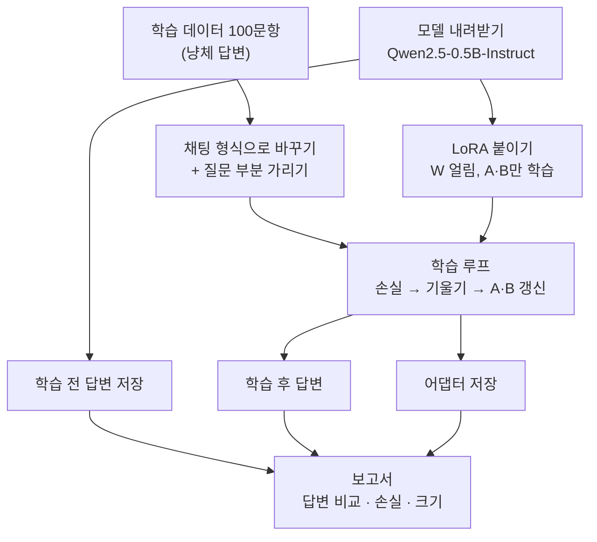

## 코드 둘러보기

| 파일 | 하는 일 |
|---|---|
| [`src/lora_demo/lora.py`](src/lora_demo/lora.py) | LoRA 붙이기, 학습 파라미터 수 세기, rank 계산표 |
| [`src/lora_demo/data.py`](src/lora_demo/data.py) | 대화를 학습용 숫자열로 바꾸고 질문 부분을 가리기 |
| [`src/lora_demo/train.py`](src/lora_demo/train.py) | 직접 쓴 짧은 학습 루프 (52줄) |
| [`src/lora_demo/evaluate.py`](src/lora_demo/evaluate.py) | 답변 생성, 말투 적중 판정, 어댑터 끄기 확인 |
| [`src/lora_demo/report.py`](src/lora_demo/report.py) | 결과를 HTML 보고서 한 장으로 만들기 (외부 파일·네트워크 없음) |
| [`src/lora_demo/cli.py`](src/lora_demo/cli.py) | `lora-demo` 명령과 6단계 진행 |

**1) LoRA 붙이기** — `lora.py`. 라이브러리 [PEFT](https://huggingface.co/docs/peft)가 `W`는 얼리고 `A`·`B`만 학습 대상으로 만듭니다.

```python
conf = LoraConfig(r=rank, lora_alpha=alpha, lora_dropout=dropout,
                  target_modules=TARGETS[targets], task_type="CAUSAL_LM")
return get_peft_model(model, conf)
```

**2) 질문은 가리고 답변만 학습** — `data.py`. 라벨을 `-100`으로 두면 손실 계산에서 제외됩니다. 모델이 질문을 외우는 게 아니라 "답하는 법"을 배우게 하려는 것입니다.

```python
labels = [-100] * len(prompt) + full[len(prompt):]
```

**3) 학습 루프** — `train.py`. 2문항씩 두 번 모아(기울기 누적) 4문항 단위로 한 번 갱신합니다. 옵티마이저에는 `requires_grad`가 켜진 것, 즉 LoRA의 A·B만 넘깁니다. (`requires_grad`: "이 숫자는 학습 대상인가"를 나타내는 PyTorch의 표시.)

```python
params = [p for p in model.parameters() if p.requires_grad]  # LoRA 의 A·B 만
opt = torch.optim.AdamW(params, lr=cfg.lr)
...
loss = model(**batch).loss / len(group)
loss.backward()   # 기울기를 쌓는다(누적)
opt.step()        # 모아 둔 기울기로 한 번 갱신
```

## 용어 사전

| 용어 | 뜻 |
|---|---|
| 파인튜닝 | 이미 학습된 모델을 내 데이터로 조금 더 학습시키는 것 |
| LoRA | 원래 숫자는 얼리고 변화량만 작은 두 표(A, B)로 배우는 방법 |
| 파라미터(가중치) | 모델 안의 조절용 숫자 하나하나 |
| W | 모델의 한 층이 가진 원래의 큰 표(행렬). LoRA 학습 중에는 고정 |
| A, B | LoRA가 새로 학습하는 작은 표. 곱하면 W에 더할 변화량(B·A)이 됨 |
| rank (r) | A와 B 사이 통로의 폭. 클수록 많이 배울 수 있지만 크기도 비례해서 커짐 |
| alpha (α) | 변화량을 더할 때 곱하는 배율(α/r)의 분자. 이 데모는 α = 2r |
| 어댑터 | 학습한 A·B만 저장한 작은 파일. 원본 모델 위에 덧붙여 쓰고 떼어 낼 수 있음 |
| 대상 모듈 (targets) | LoRA를 붙일 층. `qv`는 q·v 두 종류만, `all-linear`는 출력층을 뺀 모든 선형층 |
| 프롬프트 | 모델에 건네는 입력 문장(질문·지시) |
| 손실 (loss) | 모델 답과 정답이 얼마나 다른지 나타내는 숫자. 작을수록 좋음 |
| 에폭 (epoch) | 학습 데이터를 한 바퀴 다 보는 것 |
| 스텝 (step) | 숫자를 한 번 고치는 단위 |
| 기울기 누적 | 작은 묶음 여러 개의 기울기를 모아 한 번에 갱신해, 메모리를 아끼면서 큰 묶음 효과를 내는 방법 |
| 정규식 | 글자 모양 규칙을 적는 방법. 여기서는 말투 판정에 사용 |
| MPS | 애플 실리콘 맥의 GPU를 PyTorch가 쓰는 방식 |
| JSONL | 한 줄에 JSON 하나씩 적은 데이터 파일 |

## 직접 바꿔 보기

1. **rank 줄이기** — `uv run lora-demo --rank 4 --targets qv` → 학습 파라미터가 270,336개, 어댑터가 약 1.1MB로 줄어듭니다(보고서의 rank 표와 같은 값). 말투가 어떻게 달라지는지 보고서에서 비교해 보세요. rank가 작을수록 결과가 더 흔들릴 수 있습니다. CPU에서 `--quick`(1에폭)과 합치면 말투를 거의 못 배워 0/6 → 0/6이 나올 수 있으니(이 맥의 CPU 실측, 학습 약 45초) 실패가 아닙니다. 이 실험은 `--quick` 없이 `uv run lora-demo --device cpu --rank 4 --targets qv`로 돌리세요(같은 맥 CPU 실측: 0/6 → 6/6, 전체 약 3분).
2. **학습 길이·속도 바꾸기** — `--epochs 1`, `--lr 1e-4`, `--seed 1` 등. 학습률(lr)이 너무 낮으면 말투가 덜 배워지고, 이 데모의 기본값은 3e-4입니다. 같은 설정에서 seed만 바꿔도 적중 개수가 흔들릴 수 있습니다.
3. **내 데이터로 학습하기** — `uv run lora-demo --data 내파일.jsonl`. 형식은 한 줄에 대화 하나입니다.

   ```json
   {"messages": [{"role": "user", "content": "질문"}, {"role": "assistant", "content": "내가 원하는 말투의 답"}]}
   ```

   내 데이터를 쓰면 "냥체 적중률"은 계산하지 않습니다. 또한 전/후 답변을 비교하는 평가 질문은 내 데이터와 상관없이 기본 6개(`data/eval_prompts.json`, 냥체용 질문)가 그대로 쓰입니다. 내 분야의 질문으로 비교하고 싶다면 이 파일의 질문을 직접 바꿔 저장한 뒤 실행하세요. 보고서의 전/후 답변 표로 직접 비교하면 됩니다.
4. **결과 위치** — 실행 결과는 `runs/`에 쌓이고 최근 5개만 남습니다(`--keep-runs`로 변경, 1 이상). 어댑터 한 개가 17.6MB이므로 무한히 쌓이지 않게 한 것입니다.

보고서만 다시 만들고 싶다면:

```bash
uv run python -m lora_demo.report <result.json> <출력.html>
```

## 한계 — 말투는 바뀌지만, 내용이 맞아지는 것은 아닙니다

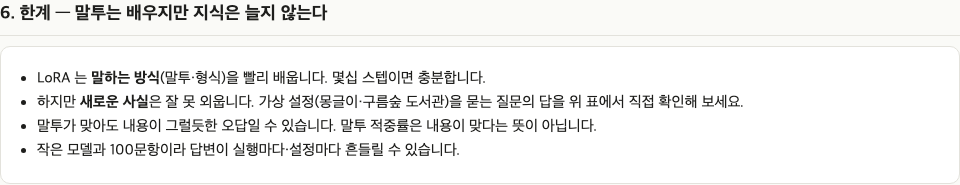
<sub>보고서에도 같은 경고가 들어 있습니다.</sub>

- 학습 후 모델은 6/6으로 냥체를 쓰지만 **내용은 엉뚱합니다.** 예: "몽글이에 대해 소개해 줘"에 "몽글이는 한 문장으로 이루어진 문장을 말한다냥", 도서관 운영 시간 질문에 "매주 수요일에 열고 달라진다냥". 학습 전에는 몽글이를 MongoDB로 착각했습니다.
- 이 데모의 데이터에는 "몽글이"나 "도서관 시간"에 대한 정보가 **없습니다.** LoRA(와 이 데이터)는 **말투를 입히는 도구**이지, 모르는 사실을 알려 주는 도구가 아닙니다.
- 모델이 작고(0.5B) 데이터가 100문항뿐이라 **결과가 실행마다 흔들립니다.** 학습률 2e-4에서는 6개 중 4개만 맞았고, 3e-4에서는 seed 0·1·2 모두 6/6이었습니다. 그래서 기본값을 3e-4로 정했습니다. 한 대의 장비에서 한 번 잰 값이므로 일반적인 보장은 아닙니다.
- "프롬프트만"이 0/6이라고 해서 프롬프트가 늘 못한다는 뜻은 아닙니다. 이 모델, 이 지시문, 이 엄격한 규칙에서의 결과입니다.

## 자주 겪는 문제

| 증상 | 원인 | 해결 |
|---|---|---|
| `uv: command not found` | uv 미설치, 또는 설치 직후 현재 터미널에 아직 반영 안 됨 | 위 "30초 만에 실행하기"의 설치 명령 실행 후 터미널을 새로 열거나 `source $HOME/.local/bin/env`를 실행합니다 |
| Python 3.14를 찾을 수 없다는 오류 | 3.14 미설치 | uv가 필요한 Python을 자동으로 내려받습니다. 막혀 있으면 `uv python install 3.14` |
| 처음 내려받기에서 `Can't assign requested address` 같은 재시도 메시지 | 모델 서버 접속이 잠깐 끊김 | 몇 번 재시도하다가 보통 성공합니다. 계속 실패하면 네트워크 확인 후 다시 실행 |
| 학습이 너무 오래 걸린다 | CPU로 도는 중 | `--device cpu --quick`(1에폭)을 쓰거나 `--mock`으로 흐름만 확인 |
| 메모리 부족(특히 맥) | 한 번에 올리는 문항이 많음 | 기본값(2문항씩 두 번 누적)이 이미 메모리를 줄인 값입니다. 다른 앱을 닫고 다시 실행 |
| 활동 모니터의 메모리가 모델 크기보다 훨씬 크게 보임 | 학습 중 임시 계산 공간이 예약됨 | 학습이 끝나면 풀립니다. 이 데모의 정상 동작입니다 |
| NVIDIA GPU가 있는데 CPU로 도는 것 같다 | Linux/Windows는 CPU 전용 PyTorch를 받도록 설정됨 | `pyproject.toml`의 `[tool.uv.sources]`와 `[[tool.uv.index]]` 블록을 지우고 [PyTorch 설치 안내](https://pytorch.org/get-started/locally/)에 맞는 CUDA 버전 휠로 바꿉니다 |
| `You are sending unauthenticated requests to the HF Hub` 경고 | 모델 서버에 토큰 없이 접속했다는 안내 | 무해합니다. 토큰(`HF_TOKEN`)은 선택이고 없어도 내려받기와 학습이 됩니다. 진행 막대나 transformers의 길이 안내 문구도 오류가 아니니 무시해도 됩니다 |
| `--mock`에서 "0/6 → 0/6" | 정상 | 무작위 모델이라 말투를 배우지 못합니다. 실제 모드로 실행하세요 |

## 더 해 보기

- **어댑터를 원본에 합치기**: PEFT의 `merge_and_unload()`로 어댑터를 원본 모델 숫자에 합치면 어댑터 없이 하나의 모델로 쓸 수 있습니다.
- **맥에서 더 간편하게**: Apple 실리콘 전용 도구 MLX-LM에도 LoRA 학습 명령이 있습니다.
- **직접 짠 학습 루프 대신**: 이 데모의 학습 루프는 50줄 남짓(52줄)한 직접 구현입니다. 같은 일을 Hugging Face `Trainer`나 TRL의 `SFTTrainer`로도 할 수 있습니다.

## 더 알아보기

- [LoRA: Low-Rank Adaptation of Large Language Models (논문)](https://arxiv.org/abs/2106.09685)
- [Hugging Face PEFT 문서 — LoRA](https://huggingface.co/docs/peft/conceptual_guides/lora)
- [Qwen2.5-0.5B-Instruct 모델 카드](https://huggingface.co/Qwen/Qwen2.5-0.5B-Instruct)
- [PyTorch 설치 안내](https://pytorch.org/get-started/locally/)
- [uv 문서](https://docs.astral.sh/uv/)

## 라이선스

- **코드**: MIT — [LICENSE](LICENSE)
- **데이터**(`data/nyang_100.jsonl`, `data/eval_prompts.json`): 직접 작성한 것으로 CC0-1.0(퍼블릭 도메인 헌정) — [data/LICENSE](data/LICENSE)
- **모델**: 이 레포에는 포함되어 있지 않고 실행할 때 내려받는 Qwen2.5-0.5B-Instruct(Apache-2.0, 별도 라이선스)입니다.
